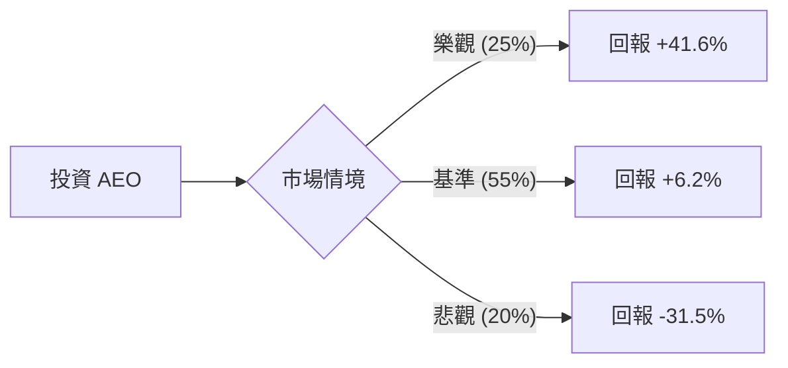

# AEO (American Eagle Outfitters) 投資價值量化分析報告

作為量化投資分析師，針對 **American Eagle Outfitters (AEO)** 的當前數據與市場動態，我將透過機率思考框架，拆解其未來 12 個月的期望值（Expected Value, EV）。

---

### 1. 核心驅動因素與風險 (Drivers & Risks)

#### **關鍵催化劑 (Catalysts)**
1.  **Aerie 品牌的持續擴張與「Offline」產品線發力**：Aerie 依然是公司的增長引擎，其在高利潤率的運動休閒（Activewear）領域市佔率持續提升。若 Aerie 能維持雙位數增長，將顯著拉抬整體毛利率。
2.  **「動力盈利增長」三年計劃 (Powering Profitable Growth)**：公司目標在未來三年實現 5-6 億美元的營業利潤。供應鏈優化與庫存管理自動化（如數據驅動的補貨系統）若能持續提升營運利潤率（目前 9.34%），將引發估值修復。
3.  **潛在的空頭擠壓 (Short Squeeze)**：目前 Short Float 高達 11.16%，在 PEG 僅 0.75 且 ROE 高達 20.36% 的基本面支撐下，任何超預期的財報都可能觸發空頭回補，推升股價爆發性上漲。

#### **主要風險點 (Risks)**
1.  **宏觀消費支出放緩**：AEO 屬於非必需消費品，受通膨與高利率環境影響較大。若美國勞動力市場轉弱，青少年與年輕成年人的可支配所得下降，將直接衝擊營收。
2.  **高度競爭壓力**：競爭對手如 Abercrombie & Fitch (ANF) 的強勢復甦以及快時尚巨頭 (Shein, Temu) 的價格戰，可能迫使 AEO 增加折扣促銷，損害毛利率。
3.  **庫存積壓風險**：服飾業對流行趨勢極為敏感，若季節性產品預測失準，將導致庫存減值，重演過去毛利受損的情境。

---

### 2. 情境設定與機率賦予 (Scenario Modeling)

基於當前股價 $21.18 與 PEG 0.75 的低估值特性，設定以下三種情境：

#### **樂觀情境 (Bull Case)**
*   **發生條件**：Aerie 營收增長 >15%，整體營運利潤率突破 11%，且成功觸發空頭擠壓。
*   **預估機率**：25%
*   **目標價格與預期回報**：**$30.00 (+41.6%)**。基於 Forward P/E 回升至 14x（歷史高位區間）與 EPS 增長超預期。

#### **基準情境 (Base Case)**
*   **發生條件**：公司達成三年計劃的年度目標，庫存維持健康，營收個位數增長。
*   **預估機率**：55%
*   **目標價格與預期回報**：**$22.50 (+6.2%)**。基於目前 P/E 11x 維持不變，反映小幅的盈利增長與股息收益。

#### **悲觀情境 (Bear Case)**
*   **發生條件**：美國經濟進入衰退，消費疲軟導致庫存積壓，毛利率跌破 35%。
*   **預估機率**：20%
*   **目標價格與預期回報**：**$14.50 (-31.5%)**。回測 52 週低點，安全邊際建立在 P/B 約 1.4x 的清算價值附近。

---

### 3. 期望值計算與決策樹 (EV Calculation & Decision Tree)

#### **決策樹結構**

#### **總期望值計算**
*   `EV = (0.25 * 41.6%) + (0.55 * 6.2%) + (0.20 * -31.5%)`
*   `EV = 10.4% + 3.41% - 6.3%`
*   **`EV = 7.51%`**

#### **風險回報比分析**
*   **上行潛力**：$30.00 - $21.18 = $8.82
*   **下行空間**：$21.18 - $14.50 = $6.68
*   **風險回報比 (Risk/Reward Ratio)**：**1 : 1.32**。雖然期望值為正，但由於近期股價已從低點反彈不少（SMA200 +16.6%），不對稱性並非極端優越。

---

### 4. 決策總結 (Decision Summary)

| 情境 | 發生機率 (%) | 預期報酬率 (%) | 關鍵驅動/觸發因素 |
| :--- | :--- | :--- | :--- |
| **樂觀 (Bull)** | 25% | +41.6% | Aerie 爆發性增長、空頭擠壓、利潤率超預期 |
| **基準 (Base)** | 55% | +6.2% | 穩健執行三年計劃、庫存控制良好 |
| **悲觀 (Bear)** | 20% | -31.5% | 宏觀經濟衰退、競爭加劇導致價格戰 |
| **整體期望值** | **100%** | **+7.51%** | **加權平均預期回報** |

**最終結論：**
1. **投資建議**：**持有 (Hold) / 逢低買入 (Buy on Dips)**
2. **核心邏輯**：AEO 目前具備極具吸引力的估值（PEG 0.75, P/E 10.8x），且 ROE 表現優異，顯示管理層資本配置效率高。然而，目前股價已高於分析師平均目標價 ($19.2)，且近期漲幅已消化部分利多。7.51% 的期望值雖為正，但考慮到零售業的高波動性，建議等待股價回落至 $20 以下（靠近 SMA50）再行加碼，以優化風險回報比。
3. **風控建議**：若股價跌破 **$18.50**（關鍵支撐位且跌破 SMA200），顯示基準情境失效，應考慮減碼；若毛利率連續兩個季度下滑，則視為進入悲觀情境的訊號，應執行止損。

【結束指令】