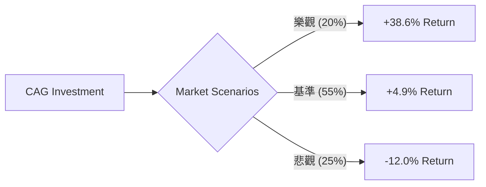

# Conagra Brands (CAG) 量化投資分析報告

作為量化投資分析師，針對 **Conagra Brands (CAG)** 的當前數據與市場環境，我將透過期望值（Expected Value, EV）模型與決策樹框架，評估其在未來 12 個月的投資價值。

---

### 1. 核心驅動因素與風險 (Drivers & Risks)

#### **關鍵催化劑 (Catalysts)**
1.  **銷量拐點與組合優化**：CAG 近期致力於從「價格驅動」轉向「銷量驅動」。若冷凍食品（Birds Eye）與零食（Slim Jim）的銷量在未來兩季出現正增長，將觸發估值修復。
2.  **降息週期的分紅吸引力**：CAG 目前提供高達 **7.08%** 的股息率。在聯準會進入降息週期時，這類高息防禦股通常會吸引尋求收益的資金流入，推升股價。
3.  **供應鏈效率提升**：公司持續進行供應鏈生產力計畫，若毛利率（目前 23.8%）能因成本控制超預期回升，將直接改善其目前為負的 ROE 狀況。

#### **主要風險點 (Risks)**
1.  **GLP-1 藥物普及的結構性威脅**：減肥藥（如 Ozempic）的普及可能長期抑制高熱量零食與加工食品的消費需求，這對 CAG 的核心產品線構成估值天花板。
2.  **高槓桿與財務壓力**：債務權益比（Debt/Eq）高達 **1.21**，且 ROE 為負（-24.89%）。在信用環境收緊或業績持續低迷時，高額利息支出將侵蝕現金流，甚至威脅股息發放。
3.  **自有品牌（Private Label）競爭**：通膨壓力下，消費者傾向轉向更便宜的超市自有品牌，CAG 若無法維持品牌溢價，市佔率將持續流失。

---

### 2. 情境設定與機率賦予 (Scenario Modeling)

基於目前股價 $14.83 與 52 週區間 ($12.53 - $20.32)，設定以下三種互斥情境：

#### **樂觀情境 (Bull Case)**
*   **發生條件**：銷量成功轉正，通膨放緩帶動毛利擴張，且市場對高息股重新定價。
*   **預估機率**：**20%**
*   **目標價格與預期回報**：**$19.50** (回歸歷史平均 P/E 約 12x)。
*   **預期總回報**：+31.5% (股價) + 7.1% (股息) = **+38.6%**

#### **基準情境 (Base Case)**
*   **發生條件**：業務維持現狀，銷量微跌但利潤率穩定，股息維持發放。符合分析師平均預期。
*   **預估機率**：**55%**
*   **目標價格與預期回報**：**$14.50** (接近目前分析師目標價 $13.71 略高處)。
*   **預期總回報**：-2.2% (股價) + 7.1% (股息) = **+4.9%**

#### **悲觀情境 (Bear Case)**
*   **發生條件**：GLP-1 衝擊超預期，或因債務壓力被迫削減股息，引發機構拋售。
*   **預估機率**：**25%**
*   **目標價格與預期回報**：**$12.00** (跌破 52 週低點，尋求安全邊際)。
*   **預期總回報**：-19.1% (股價) + 7.1% (股息) = **-12.0%**

---

### 3. 期望值計算與決策樹 (EV Calculation & Decision Tree)

#### **決策樹結構**

#### **總期望值計算**
*   **EV** = (0.20 * 38.6%) + (0.55 * 4.9%) + (0.25 * -12.0%)
*   **EV** = 7.72% + 2.695% - 3.0% = **7.415%**

#### **風險回報比分析**
*   **上行潛力 (Upside)**：相較於基準點有約 23.7% 的超額回報空間。
*   **下行空間 (Downside)**：約 16.9% 的虧損風險。
*   **不對稱性**：EV 為正值，但主要由高股息支撐。若扣除股息，純股價變動的 EV 接近於零，顯示目前股價已充分反映其基本面困境。

---

### 4. 決策總結 (Decision Summary)

| 情境 | 發生機率 (%) | 預期報酬率 (%) | 關鍵驅動/觸發因素 |
| :--- | :--- | :--- | :--- |
| **樂觀 (Bull)** | 20% | +38.6% | 銷量增長轉正、降息帶動估值修復 |
| **基準 (Base)** | 55% | +4.9% | 股息維持、業績符合預期、市場情緒平淡 |
| **悲觀 (Bear)** | 25% | -12.0% | 股息削減、GLP-1 衝擊加劇、債務違約風險 |
| **整體期望值** | **100%** | **7.42%** | **加權平均預期回報 (含股息)** |

**最終結論：**
1.  **投資建議**：**持有 (Hold) / 觀望 (Wait)**
2.  **核心逻辑**：CAG 目前處於典型的「價值陷阱」邊緣。雖然 7.42% 的期望值為正，但這幾乎完全依賴於高股息的貢獻。負的 ROE 與高債務比顯示公司內部增長動力缺失。在缺乏強大銷量催化劑的情況下，目前的期望值不足以補償其結構性風險（如 GLP-1 影響）。
3.  **風控建議**：若股價跌破 **$12.50** (52W Low) 或公司宣佈**削減股息**，應立即執行止損，因為這意味著悲觀情境全面發生，下行空間將進一步打開。