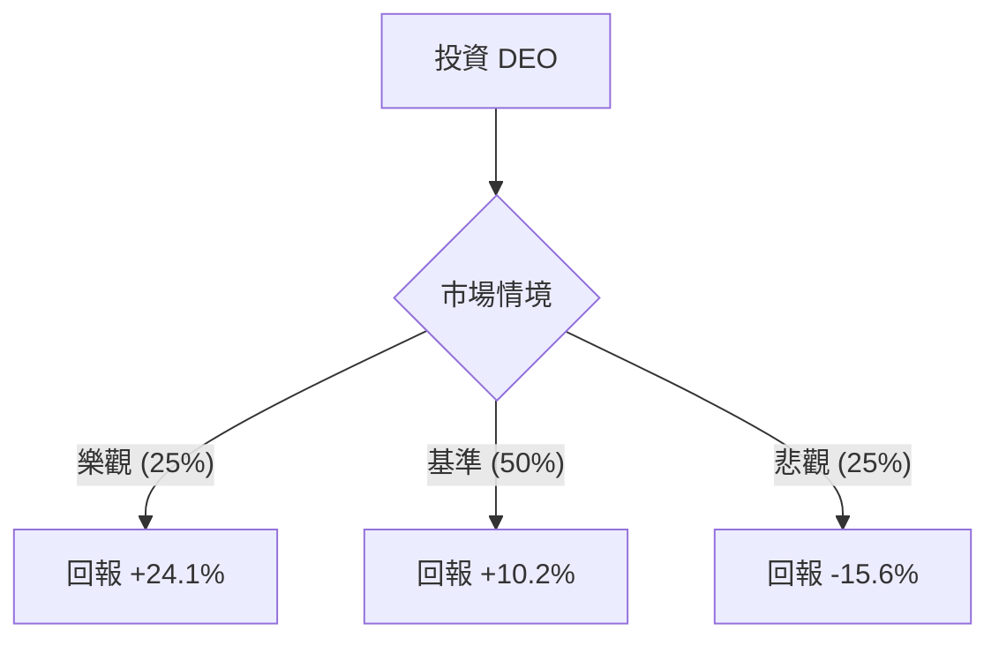

# DEO (Diageo plc ADR) 量化投資分析報告

作為量化投資分析師，針對 Diageo (DEO) 的當前數據與市場動態，我將透過機率模型與期望值 (EV) 框架進行深度拆解。DEO 目前正處於估值修復與業務轉型的交界點。

---

### 1. 核心驅動因素與風險 (Drivers & Risks)

#### **關鍵催化劑 (Catalysts)**
1.  **拉丁美洲與加勒比海 (LAC) 庫存去化完成**：DEO 過去一年的股價低迷主因在於 LAC 地區的庫存積壓。若未來 6-12 個月財報顯示該區銷售回歸正常化，將引發強烈的估值修復（Mean Reversion）。
2.  **利息支出壓力緩解**：DEO 的負債比（Debt/Eq 2.04）較高。隨著全球進入降息週期，其利息支出負擔將減輕，且作為高股息防禦股，其相對吸引力將提升。
3.  **生產力提升計畫 (Productivity Program)**：公司目標在 2027 財年前達成 20 億美元的成本節約，若利潤率（目前 Oper. Margin 28.93%）能因此回升，將直接推動 EPS 超預期。

#### **主要風險點 (Risks)**
1.  **消費降級 (Trade-down) 趨勢**：在高通膨與經濟放緩背景下，消費者可能從高端烈酒轉向平價品牌，威脅 DEO 的「高端化 (Premiumization)」戰略。
2.  **地緣政治與關稅風險**：烈酒常成為貿易爭端的報復目標（如中歐貿易摩擦、美歐關稅潛在風險），這將直接衝擊其全球供應鏈與利潤。
3.  **競爭加劇與市佔流失**：在龍舌蘭 (Tequila) 與即飲酒 (RTD) 領域，新興品牌與競爭對手（如 Pernod Ricard）的激進擴張可能侵蝕其核心市佔。

---

### 2. 情境設定與機率賦予 (Scenario Modeling)

基於 Forward P/E 僅 14.27 倍（遠低於歷史均值 20-22 倍）與當前市場情緒，設定以下三種情境：

#### **樂觀情境 (Bull Case)**
*   **發生條件**：LAC 地區銷售強勁反彈，美國市場恢復中個位數增長，且成本節約計畫提前達標。市場情緒轉向，估值倍數回升至 18x Forward P/E。
*   **預估機率**：25%
*   **目標價格與預期回報**：$125.00 (約 +24.1%)

#### **基準情境 (Base Case)**
*   **發生條件**：業務緩步復甦，LAC 庫存問題解決但全球消費情緒平淡。EPS 增長符合分析師預期的 5.17%。估值倍數維持在 15-16x。
*   **預估機率**：50%
*   **目標價格與預期回報**：$111.00 (約 +10.2%)

#### **悲觀情境 (Bear Case)**
*   **發生條件**：全球經濟衰退導致高端酒類需求萎縮，且面臨新的貿易關稅制裁。EPS 出現負增長，股價回測 52 週低點。
*   **預估機率**：25%
*   **目標價格與預期回報**：$85.00 (約 -15.6%)

---

### 3. 期望值計算與決策樹 (EV Calculation & Decision Tree)

#### **決策樹結構**

#### **總期望值計算**
*   **EV** = (0.25 * 24.1%) + (0.50 * 10.2%) + (0.25 * -15.6%)
*   **EV** = 6.025% + 5.1% - 3.9% = **7.225%**

#### **風險回報比分析**
*   **上行潛力 (Upside)**：+24.1% (樂觀)
*   **下行空間 (Downside)**：-15.6% (悲觀)
*   **風險回報比**：1 : 1.54。這顯示每承擔 1 單位的風險，預期可獲得 1.54 單位的回報，具備正向不對稱性。

---

### 4. 決策總結 (Decision Summary)

| 情境 | 發生機率 (%) | 預期報酬率 (%) | 關鍵驅動/觸發因素 |
| :--- | :--- | :--- | :--- |
| **樂觀 (Bull)** | 25% | +24.1% | LAC 復甦超預期、估值倍數修復至 18x |
| **基準 (Base)** | 50% | +10.2% | 業務平穩增長、達到分析師目標價 $111 |
| **悲觀 (Bear)** | 25% | -15.6% | 全球衰退、消費降級、關稅制裁 |
| **整體期望值** | **100%** | **+7.23%** | **加權平均預期回報 (具備安全邊際)** |

**最終結論：**
1.  **投資建議**：**買入 (Buy)**
2.  **核心邏輯**：DEO 目前的 Forward P/E (14.27) 處於十年來的歷史低位，市場已過度反應 LAC 的短期利空。7.23% 的期望值雖非暴利，但在防禦性板塊中極具吸引力，且 1.54 的風險回報比提供了良好的安全邊際。
3.  **風控建議**：若股價跌破 $85 (悲觀情境支撐位) 或連續兩個季度 EPS Q/Q 惡化超過 5%，應視為基本面惡化訊號，執行止損或減碼。