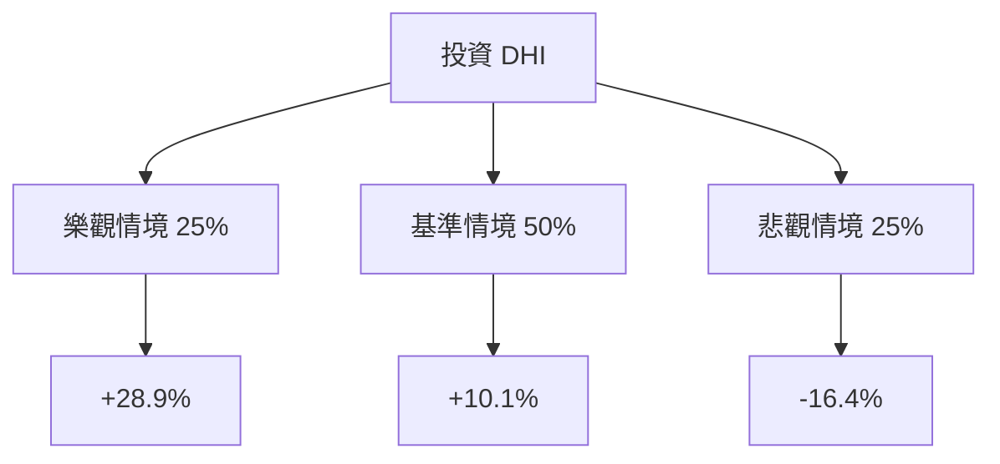

# D.R. Horton Inc (DHI) 量化投資分析報告

作為量化投資分析師，針對全美最大房屋建造商 D.R. Horton (DHI) 的分析將聚焦於利率週期、庫存結構與利潤率的概率分佈。目前 DHI 股價處於 52 週高點回落約 16% 的位置，估值（P/E 14.16x）處於歷史中軸，顯示市場正在重新定價房地產市場的復甦節奏。

---

### 1. 核心驅動因素與風險 (Drivers & Risks)

#### **關鍵催化劑 (Catalysts)**
1.  **聯準會降息週期與抵押貸款利率下行**：DHI 對利率極度敏感。隨著聯準會進入降息週期，30 年期抵押貸款利率若能穩定回落至 6% 以下，將顯著釋放被壓抑的購屋需求，並降低 DHI 為了促銷而支付的「利率買斷 (Mortgage Buy-downs)」成本，直接提振毛利率。
2.  **成屋庫存結構性短缺**：美國成屋供應依然偏緊，許多屋主因鎖定低利率而不願換屋（鎖定效應）。這迫使買方轉向新成屋市場。DHI 憑藉其規模優勢與快速週轉模式，能提供比個體賣家更具吸引力的融資方案，持續擴大市佔率。
3.  **資本配置優化**：DHI 擁有強勁的資產負債表（Debt/Eq 0.26），且持續進行股份回購與穩定派息。預期下一財年 EPS 增長率達 22.41%，這將成為股價重估 (Re-rating) 的核心動力。

#### **主要風險點 (Risks)**
1.  **通膨黏性導致利率「Higher for Longer」**：若通膨回落不及預期，導致市場修正降息預期，抵押貸款利率回升將直接打擊銷量，並迫使 DHI 增加促銷激勵，壓縮利潤空間。
2.  **宏觀經濟衰退與失業率上升**：房地產是經濟的領先指標。若美國勞動力市場惡化，即使利率下降，購屋者的信用能力與信心也會受損，導致訂單取消率上升。
3.  **利潤率受壓**：為了維持銷量，DHI 目前依賴大量的激勵措施。若競爭對手發起價格戰，或建築成本（人工與建材）再度上漲，其 22.28% 的毛利率將面臨下行壓力。

---

### 2. 情境設定與機率賦予 (Scenario Modeling)

基於未來 12 個月的宏觀環境與 DHI 基本面，設定以下三種互斥情境：

#### **樂觀情境 (Bull Case)**
*   **發生條件**：美國經濟實現「軟著陸」，聯準會降息節奏超預期，抵押貸款利率降至 5.5%-5.8%。DHI 銷量大幅增長，且因需求強勁減少了利率買斷補貼，毛利率回升至 24% 以上。
*   **預估機率**：25%
*   **目標價格與預期回報**：$185 (基於 Forward P/E 16x) | **預期回報：+28.9%**

#### **基準情境 (Base Case)**
*   **發生條件**：利率緩步下行，房地產市場維持「低溫復甦」。DHI 憑藉規模優勢維持市佔率，EPS 達成市場預期的 22% 增長，但激勵措施仍需維持以支撐銷量。
*   **預估機率**：50%
*   **目標價格與預期回報**：$158 (基於 Forward P/E 14x) | **預期回報：+10.1%**

#### **悲觀情境 (Bear Case)**
*   **發生條件**：通膨反彈導致利率重回 7% 以上，或經濟進入實質衰退導致失業率飆升。DHI 必須降價去庫存，EPS 出現負增長，估值收縮。
*   **預估機率**：25%
*   **目標價格與預期回報**：$120 (基於 P/B 1.4x 安全邊際) | **預期回報：-16.4%**

---

### 3. 期望值計算與決策樹 (EV Calculation & Decision Tree)

#### **決策樹結構**

#### **總期望值計算**
*   **EV** = (0.25 * 28.9%) + (0.50 * 10.1%) + (0.25 * -16.4%)
*   **EV** = 7.225% + 5.05% - 4.1% = **8.175%**

#### **風險回報比分析**
*   **上行潛力 (Upside)**：$185 - $143.52 = $41.48
*   **下行空間 (Downside)**：$143.52 - $120 = $23.52
*   **風險回報比 (Risk/Reward Ratio)**：1 : 1.76
*   **分析**：期望值為正（8.18%），且風險回報比優於 1:1.5，顯示目前價位具備投資吸引力，但並非極度低估。

---

### 4. 決策總結 (Decision Summary)

| 情境 | 發生機率 (%) | 預期報酬率 (%) | 關鍵驅動/觸發因素 |
| :--- | :--- | :--- | :--- |
| **樂觀 (Bull)** | 25% | +28.9% | 降息超預期、毛利率回升、需求爆發 |
| **基準 (Base)** | 50% | +10.1% | 利率平穩下行、EPS 增長 22%、市佔擴大 |
| **悲觀 (Bear)** | 25% | -16.4% | 通膨反彈、經濟衰退、激勵成本過高 |
| **整體期望值** | **100%** | **+8.18%** | **加權平均預期回報** |

**最終結論：**
1.  **投資建議**：**買入 (Buy)**
2.  **核心逻辑**：DHI 的期望值為正（8.18%），反映了其在住房短缺背景下的結構性優勢。雖然短期受利率波動干擾，但其極低的負債率（0.26）與強大的現金流（P/FCF 11.64）提供了極高的容錯率。目前股價低於分析師平均目標價與 52 週高點，提供了合理的進入點。
3.  **風控建議**：若股價跌破 **$130**（52 週低點附近且 SMA200 失守），需重新評估宏觀衰退風險。若毛利率連續兩個季度下滑超過 200 個基點，則視為基本面惡化訊號，應執行減碼或止損。