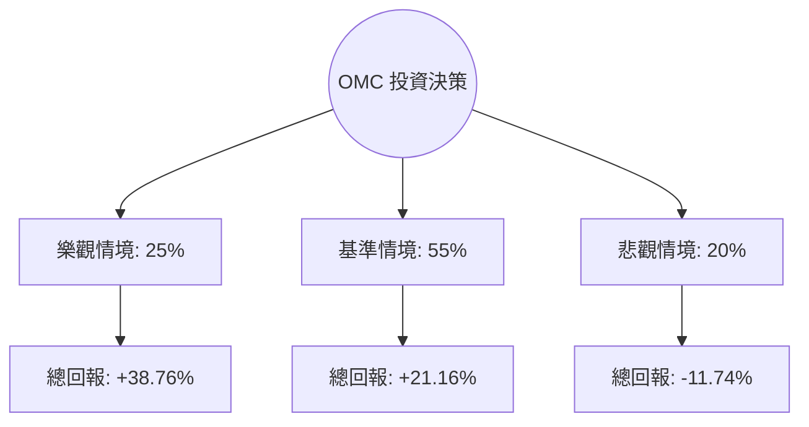

# OMC (Omnicom Group, Inc.) 投資價值量化分析報告

作為量化投資分析師，我將結合您提供的財務數據與最新的市場動態（包含 Flywheel Digital 收購進展、AI 平台 Omni 的整合以及 2024/2025 廣告市場預期），對 OMC 進行期望值模型分析。

---

### 1. 核心驅動因素與風險 (Drivers & Risks)

#### **關鍵催化劑 (Catalysts)**
1.  **高利潤數位轉型與 Flywheel 整合**：OMC 收購 Flywheel Digital 後，正加速從傳統廣告代理轉向「零售媒體（Retail Media）」與「電商數據」。這不僅提升了有機增長率（Organic Growth），其高利潤率特性有望推動 Forward P/E 的估值修復。
2.  **AI 驅動的營運效率提升**：透過其 Omni 平台與生成式 AI 的深度整合，OMC 在內容創作與精準投放上的成本結構正在優化。市場預期這將反映在未來 6-12 個月的營業利益率（Operating Margin）擴張。
3.  **強勁的股東回報與低估值修復**：目前 Forward P/E 僅 7.51，遠低於歷史均值與標普 500 平均水平。配合 3.76% 的股息率與穩定的股份回購，具備強大的下行支撐。

#### **主要風險點 (Risks)**
1.  **宏觀經濟放緩導致廣告預算削減**：廣告支出與 GDP 高度相關。若 2025 年全球經濟增長低於預期，企業首要削減的就是行銷預算。
2.  **高槓桿與利率壓力**：Debt/Eq 為 1.14，在長期高利率環境下，債務再融資成本可能侵蝕淨利潤。
3.  **技術去中心化挑戰**：大型科技平台（如 Google, Meta, Amazon）持續強化自有的廣告工具，可能進一步壓縮傳統廣告代理商的中介價值。

---

### 2. 情境設定與機率賦予 (Scenario Modeling)

基於當前股價 $85.18 與分析師目標價 $99.77，設定未來 12 個月情境：

#### **樂觀情境 (Bull Case)**
*   **發生條件**：Flywheel 整合產生顯著協同效應，有機增長超過 7%；AI 工具使營業利益率提升 >100bps；聯準會降息帶動企業擴大行銷支出。
*   **預估機率**：25%
*   **目標價格與預期回報**：**$115 (+35.0%)**。基於 Forward P/E 回升至 10x（歷史中值水平）加上 3.76% 股息。

#### **基準情境 (Base Case)**
*   **發生條件**：業務維持穩定，有機增長保持在 4-5% 區間；利潤率持平；市場情緒中性。
*   **預估機率**：55%
*   **目標價格與預期回報**：**$100 (+17.4%)**。接近分析師共識目標價，反映合理的價值修復與 3.76% 股息。

#### **悲觀情境 (Bear Case)**
*   **發生條件**：全球經濟衰退；主要客戶流失；債務成本大幅上升導致 EPS 負增長。
*   **預估機率**：20%
*   **目標價格與預期回報**：**$72 (-15.5%)**。回測 52 週低點附近，尋求安全邊際支撐，扣除股息後總回報約 -11.7%。

---

### 3. 期望值計算與決策樹 (EV Calculation & Decision Tree)

#### **決策樹結構**

#### **總期望值計算**
*   **EV** = (0.25 * 38.76%) + (0.55 * 21.16%) + (0.20 * -11.74%)
*   **EV** = 9.69% + 11.64% - 2.35% = **18.98%**

#### **風險回報比分析**
*   **上行潛力 (Upside)**：平均約 +25.5% (Bull & Base 加權)
*   **下行空間 (Downside)**：-11.74%
*   **風險回報比**：**1 : 2.17**。這顯示每承擔 1 單位的風險，預期可獲得 2.17 單位的回報，具備統計學上的投資吸引力。

---

### 4. 決策總結 (Decision Summary)

| 情境 | 發生機率 (%) | 預期報酬率 (%) | 關鍵驅動/觸發因素 |
| :--- | :--- | :--- | :--- |
| **樂觀 (Bull)** | 25% | +38.76% | Flywheel 爆發增長、AI 顯著提振利潤率、估值倍數修復 |
| **基準 (Base)** | 55% | +21.16% | 有機增長穩健、股息發放正常、符合分析師預期 |
| **悲觀 (Bear)** | 20% | -11.74% | 宏觀衰退、廣告預算大幅削減、債務壓力增加 |
| **整體期望值** | **100%** | **+18.98%** | **具備高度吸引力的風險溢酬** |

**最終結論：**
1.  **投資建議**：**買入 (Buy)**
2.  **核心逻辑**：OMC 目前處於「低估值、高現金流」的非對稱博弈區間。Forward P/E 7.51 與 PEG 0.52 顯示市場嚴重低估了其數位轉型與 AI 整合的潛力。18.98% 的期望回報率遠高於市場平均水平，且 3.76% 的股息提供了良好的下行緩衝。
3.  **風控建議**：若股價跌破 **$78**（SMA200 附近且跌破近期支撐），需重新評估基準情境是否轉向悲觀；若有機增長率連續兩個季度低於 2%，則視為核心競爭力受損，應執行減碼或止損。

【結束指令】