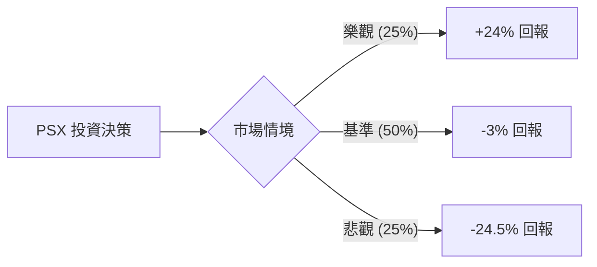

# Phillips 66 (PSX) 投資價值定量分析報告

作為量化投資分析師，我將基於您提供的數據（現價 $278.18，注意：此價格顯著高於歷史均值，暗示市場已計入極高預期）結合當前宏觀環境與公司特定催化劑，進行期望值（Expected Value）建模分析。

---

### 1. 核心驅動因素與風險 (Drivers & Risks)

#### **關鍵催化劑 (Catalysts)**
1.  **激進投資者 Elliott Management 的推動**：Elliott 持有約 10 億美元股份，正強力施壓管理層優化資產組合、削減 14 億美元的運營成本，並要求更換董事會成員。若成本削減進度超預期，將直接提振營業利潤率（Oper. Margin 目前僅 5.9%）。
2.  **非核心資產剝離與資本回報**：公司計劃通過出售非核心資產籌集超過 30 億美元。若資產剝離以高溢價完成，將加速股份回購（目前 Short Float 僅 1.38%，顯示空頭壓力小）並提升每股盈餘（EPS）。
3.  **中游業務與再生燃料轉型**：Rodeo 再生燃料設施的全面投產將減少對傳統煉油利潤（Crack Spreads）的依賴，提供更穩定的現金流估值溢價。

#### **主要風險點 (Risks)**
1.  **煉油利差（Crack Spreads）收窄**：全球經濟增速放緩可能導致成品油需求下降，若煉油毛利從高位回落，PSX 的盈利能力將面臨巨大壓力（目前 Gross Margin 僅 7.92%）。
2.  **執行風險與成本通脹**：儘管有成本削減計劃，但勞動力與材料成本的粘性可能導致 14 億美元的目標無法如期達成。
3.  **估值回歸壓力**：目前股價（$278.18）遠高於分析師平均目標價（$267.28），且 SMA200 偏離度高達 48.27%，技術面存在嚴重的超買回撤風險。

---

### 2. 情境設定與機率賦予 (Scenario Modeling)

基於未來 12 個月的展望，設定以下三個互斥情境：

#### **樂觀情境 (Bull Case)**
*   **發生條件**：Elliott 改革方案完美落地，運營成本削減超額完成；煉油利差維持高位；資產剝離溢價成交。
*   **預估機率**：25%
*   **目標價格與預期回報**：**$345 (+24%)**。基於 Forward P/E 從 10.19x 修復至 13x（行業領先水平）。

#### **基準情境 (Base Case)**
*   **發生條件**：公司按部就班執行戰略，利潤率小幅改善，但受限於宏觀需求平淡，股價在當前高位震盪或小幅修正至分析師共識水平。
*   **預估機率**：50%
*   **目標價格與預期回報**：**$270 (-3%)**。回歸分析師平均目標價與基本面支撐位。

#### **悲觀情境 (Bear Case)**
*   **發生條件**：全球經濟衰退導致能源需求崩潰；煉油利差大幅收窄；改革進度受阻。
*   **預估機率**：25%
*   **目標價格與預期回報**：**$210 (-24.5%)**。回歸 SMA200 附近，尋求安全邊際。

---

### 3. 期望值計算與決策樹 (EV Calculation & Decision Tree)

#### **決策樹結構**

#### **總期望值計算**
$EV = (0.25 \times 24\%) + (0.50 \times -3\%) + (0.25 \times -24.5\%)$
$EV = 6\% - 1.5\% - 6.125\% = \mathbf{-1.625\%}$

#### **風險回報比分析**
*   **上行潛力**：24%
*   **下行空間**：24.5%
*   **分析**：目前風險回報比接近 1:1，但由於期望值為負（-1.625%），顯示在當前 $278.18 的價位進入，數學上的「贏面」並不具備吸引力。股價已過度透支了未來的利多預期。

---

### 4. 決策總結 (Decision Summary)

| 情境 | 發生機率 (%) | 預期報酬率 (%) | 關鍵驅動/觸發因素 |
| :--- | :--- | :--- | :--- |
| **樂觀 (Bull)** | 25% | +24% | Elliott 改革超預期、資產高溢價剝離 |
| **基準 (Base)** | 50% | -3% | 符合市場共識、估值回歸平均水平 |
| **悲觀 (Bear)** | 25% | -24.5% | 經濟衰退、煉油利差崩潰、技術面回撤 |
| **整體期望值** | **100%** | **-1.625%** | **加權平均預期回報為負** |

**最終結論：**
1. **投資建議**：**避開 (Avoid) / 逢高減碼 (Reduce)**
2. **核心逻辑**：儘管 PSX 具備強大的改革催化劑（Elliott 效應）且 PEG 僅 0.22 顯示長期增長廉價，但短期股價已嚴重偏離均線（SMA200 +48%）且高於分析師目標價。期望值模型顯示目前價位的數學贏面為負，市場已將大部分利多定價（Priced-in），缺乏足夠的安全邊際。
3. **風控建議**：若已持倉，建議將止盈位設在 $265（跌破 SMA20 處）；若未持倉，建議等待股價回落至 $230-$240 區間（SMA50 附近）且煉油利差企穩後再行介入。【結束指令】